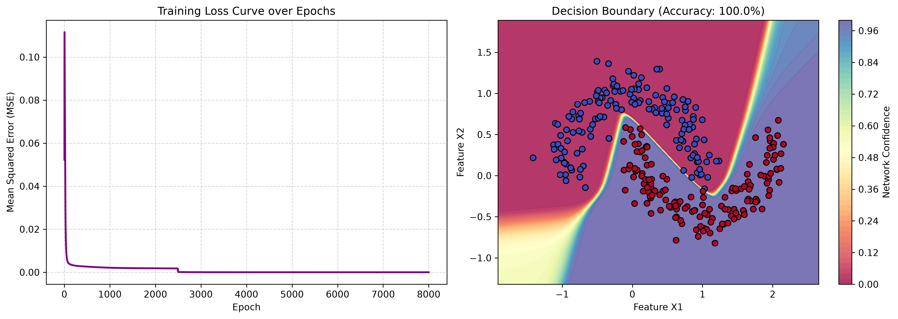

# Machine Learning and Mathematics: Deep Neural Network from Scratch

A modular, production-grade deep learning framework built completely from scratch using **only Python and NumPy**—with zero reliance on PyTorch, TensorFlow, or Scikit-Learn. 

Designed to demonstrate a rigorous, foundational understanding of matrix calculus, forward/backward propagation, numerical gradient checking, and non-linear decision boundaries.

---

## 🏗️ Architecture & Engine Overview

The framework is built around modular, decoupled components mirroring industrial deep learning APIs:
1. **`Linear` Layer**: Computes $Z = XW + b$ and executes full vector-matrix backpropagation transpose mechanics (`dW`, `db`, `dx`).
2. **`Sigmoid` Activation**: Applies $\sigma(z) = \frac{1}{1 + e^{-z}}$ and caches outputs for local gradient scaling.
3. **`MSELoss` Function**: Computes Mean Squared Error and provides starting gradient initialization.
4. **`Network` Container**: Sequentially chains layers forward and traverses them in reverse order (`reversed`) during backprop.
5. **`SGD` Optimizer**: Applies stochastic gradient descent updates across parameters.

---

## 📊 Visual Results & Validation

### 1. Numerical Gradient Verification (Phase 3)
Before training, backpropagation gradients are rigorously audited against central-difference numerical estimates ($\frac{L(\theta+h) - L(\theta-h)}{2h}$). All parameters achieve relative errors $< 10^{-11}$, mathematically proving the chain-rule derivations are flawless.

### 2. Training Convergence & Decision Boundary (Two Moons Dataset)
Trained on the highly non-linear **Two Moons dataset** (300 samples with Gaussian noise):
* **Architecture:** 2 Inputs $\rightarrow$ 8 Hidden Neurons (Sigmoid) $\rightarrow$ 1 Output Neuron (Sigmoid).
* **Optimization:** 8,000 Epochs via SGD ($\text{lr} = 0.8$).

---

## 🚀 Quick Start & Execution

1. Clone the repository:
   ```bash
   git clone [https://github.com/semalign/machine-learning-and-mathematics.git](https://github.com/semalign/machine-learning-and-mathematics.git)
   cd machine-learning-and-mathematics
2. install dependencies:
    ```bash
       pip install -r requirements.txt
3. Run training and visualizations:
    ```bash 
    python train.py
